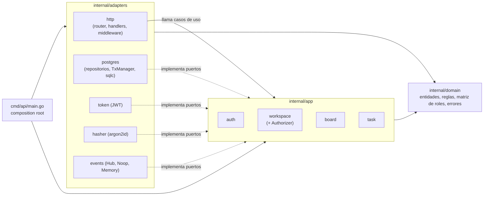

# Decisiones de arquitectura

## 1. Concurrencia optimista con columna `version` en `tasks`

Cada fila de `tasks` tiene una columna entera `version`. Toda actualización debe enviar la versión que el cliente leyó, y el `UPDATE` solo se aplica si coincide (`WHERE id = $1 AND version = $2`), incrementándola en el mismo paso.

Si no coincide, la API responde **409 Conflict** con el estado actual de la tarea en el cuerpo, para que el cliente pueda reconciliar sin otra petición.

**Por qué:** evita sobrescrituras silenciosas entre usuarios simultáneos sin necesidad de bloqueos.

## 2. Orden de tarjetas con `position` fraccionaria

El orden dentro de una columna se guarda en un campo `position` numérico fraccionario. Al mover una tarjeta entre A y B, su nueva posición es el punto medio `(A + B) / 2`; al inicio o al final se resta o suma un paso fijo.

**Por qué:** mover una tarjeta modifica una sola fila en lugar de renumerar toda la columna. Si la precisión se agota tras muchas inserciones en el mismo hueco, se rebalancea la columna.

## 3. SSE para tiempo real

Los cambios se envían a los clientes mediante **Server-Sent Events** (`text/event-stream`). Las escrituras siguen yendo por la API REST normal.

**Por qué:** el flujo en tiempo real es solo servidor → cliente; SSE funciona sobre HTTP estándar, reconecta automáticamente y es más simple que WebSockets.

Cómo está hecho (`GET /boards/{id}/events`):

- **Hub en memoria** (`adapters/events.Hub`): implementa el puerto `EventPublisher` de los casos de uso y el puerto `EventSubscriber` de `board.StreamService`. Guarda suscriptores por board, cada uno con un canal con buffer (64 eventos). **Publicar nunca bloquea:** si el buffer de un suscriptor está lleno (cliente lento), el hub lo da de baja y cierra su canal. El handler termina el stream, y `EventSource` reconecta y recupera lo perdido con `Last-Event-ID`. Un cliente lento no frena las escrituras ni a los demás clientes.
- **Eventos de dominio:** `task.created`, `task.updated`, `task.archived`, `task.moved`, `task.deleted`, `column.created`, `column.updated`, `column.reordered`, `column.deleted` y `label.changed`.
  - Cada cambio de contenido de un board escribe una entrada en `activity_log`, en la misma transacción, y **esa entrada es el evento**: `id` SSE = id de la fila, `event` = tipo, `data` = actor, la entidad completa (al crear) o los campos cambiados, y la `version` resultante de la tarea.
  - Los casos de uso publican solo tras el commit.
  - En la tabla se conservan los nombres de tipo de antes (`task_created`…), así que `/activity` no cambia de forma. El nombre con punto es el del evento, y la correspondencia está en `domain`.
  - `task.archived` es una edición que archiva. Al desarchivar se envía `task.updated`.
  - Si un movimiento obliga a reequilibrar, `task.moved` y `column.reordered` incluyen `rebalanced` con las nuevas posiciones, porque las demás filas cambian de posición sin ser editadas.
- **El log es la fuente; el hub solo despierta:** cada stream recuerda el id de lo último que envió y, al despertar, lee del log todo lo posterior. No hay huecos ni duplicados aunque dos `Publish` lleguen desordenados.
- **Orden de commit = orden de id, por board:** sin esto, dos transacciones del mismo board podrían tomar los ids 10 y 11 y confirmar 11 antes que 10, y un cliente que ya vio 11 nunca recibiría 10.
  - `activity.Append` toma `pg_advisory_xact_lock(board)` justo antes de insertar y lo mantiene hasta el commit. Las escrituras de un board se serializan solo en ese último paso.
  - Para que no haya interbloqueos, todo escritor lo toma **al final** y después solo inserta y lee. Por eso `LockBoard` pasó a `FOR NO KEY UPDATE`, compatible con el `KEY SHARE` de la FK de `activity_log`. Por la misma razón, el desasignado al quitar un miembro bloquea primero las tareas y luego los boards en orden.
  - Hay un test con 40 escrituras concurrentes que recibe los ids en el mismo orden que el log. Sin el lock pierde eventos.
- **Reconexión:** el stream se suscribe **antes** de leer el log, y luego reenvía lo posterior a `Last-Event-ID` (o `?last_event_id=` para un `EventSource` nuevo) antes de pasar al vivo.
  - Si faltan más de 500 eventos, o el id es mayor que el último del board, envía `event: resync` con `id` = el último evento: el cliente recarga el board y sigue desde ahí.
  - Sin `Last-Event-ID`, el stream empieza en vivo.
- **Presencia, derivada del stream y sin tabla:** el hub cuenta, por board y usuario, las conexiones abiertas. Varias pestañas son una presencia.
  - `presence.joined` sale cuando se abre la primera conexión. `presence.left` sale cuando se cierra la última **y pasan 4 s** sin que vuelva. Si reconecta antes (una recarga de página), no se envía nada; durante esos segundos sigue contando como presente.
  - Suscribirse y unirse a la presencia es un solo paso bajo el mutex del hub. Así el `presence.snapshot` de una conexión nueva cuadra con los eventos que llegan después, y esa conexión no recibe su propio `joined`.
  - Los mensajes de presencia van **sin `id` SSE**: según el estándar, el navegador conserva entonces el último `Last-Event-ID`, así que no interfieren con el reenvío desde `activity_log`. Tampoco se reenvían, porque cada conexión recibe el estado completo en su snapshot.
  - `GET /boards/{id}/presence` devuelve lo mismo sin abrir el stream.
  - Límite: como el hub, la presencia vive en un proceso; con varias instancias haría falta compartirla.
- **Excluir los propios eventos** solo si se pide: `?exclude_self=true` o `X-Exclude-Self: true`.
- Antes de todo se envía `retry: 3000`.
- **Autenticación por cookie:** `EventSource` no puede enviar cabeceras, así que login y registro también fijan el access token en la cookie `access_token` (`HttpOnly; SameSite=Lax; Path=/boards`). **Solo** el stream la acepta (también acepta Bearer). El resto de la API sigue exigiendo la cabecera `Authorization`, de modo que la cookie no permite CSRF sobre rutas que escriben, y el stream es de solo lectura y está protegido por CORS.
- **Permiso:** cualquier rol que pueda leer el board (viewer o más), con el mismo `requireAccess` y el mismo 403 que el resto. **Cada heartbeat (`: ping`, cada 25 s) vuelve a comprobar el acceso**: si al usuario lo quitan del workspace, su stream se cierra en el siguiente ping.
- **Timeouts:** el servidor tiene `WriteTimeout` de 30 s para las respuestas normales. El stream lo reemplaza en su propia conexión con `http.ResponseController`: antes de cada escritura fija un plazo de 10 s y después hace `Flush`. El stream puede durar indefinidamente, pero una conexión muerta se detecta en la siguiente escritura. Un test lo comprueba con un `WriteTimeout` de 150 ms: sin el `ResponseController`, el stream se corta.
- **Fin limpio:** el stream termina cuando se cancela el contexto (el cliente se desconecta), cuando el hub cierra el canal o al apagar el servidor (`RegisterOnShutdown(hub.Close)`), y siempre cancela su suscripción.
- **Límites conocidos:** el hub vive en la memoria de un proceso; con varias instancias haría falta un bus compartido (por ejemplo `LISTEN/NOTIFY` de Postgres) detrás del mismo puerto. Los ids no son consecutivos por board (la secuencia es de toda la tabla); solo crecen. El access token se comprueba al conectar, así que un stream abierto sobrevive a su caducidad hasta que se reconecta. Cuando exista `/auth/refresh`, el cliente renovará la cookie antes de reconectar.

## 4. Autenticación: JWT de acceso corto y refresh token opaco en cookie

- **Contraseñas** con **argon2id** (parámetros mínimos de OWASP: 19 MiB, 2 iteraciones, 1 hilo) en formato PHC (`$argon2id$v=19$m=…,t=…,p=…$sal$hash`). Los parámetros viajan en el hash, así que se pueden endurecer sin invalidar los existentes. La contraseña debe tener entre 8 y 128 caracteres; el máximo acota el coste de hashear por petición.
- **Access token:** JWT HS256 de 15 minutos con `sub` = id de usuario e `iss` = `tablero`. Al verificar se exige HS256 (rechaza `alg: none` y otros algoritmos), el emisor y la expiración. El cliente lo envía en `Authorization: Bearer`.
- **Refresh token:** valor aleatorio de 32 bytes en la cookie `refresh_token` (`HttpOnly; Secure; SameSite=Lax; Path=/auth`, 30 días). En la base solo se guarda su **SHA-256** (tabla `refresh_tokens`), de modo que una fuga de la base no da sesiones válidas. `Path=/auth` evita que viaje en el resto de peticiones.
- **Login sin pistas:** cualquier fallo (correo inexistente, contraseña incorrecta, campos vacíos) responde el mismo `401` con el mismo cuerpo, "Correo o contraseña incorrectos". Si el correo no existe se verifica igualmente un hash ficticio, para que el tiempo de respuesta no delate qué cuentas existen.
- **Pendiente:** `/auth/refresh` (rotación del refresh token) y `/auth/logout` (revocación); la tabla ya tiene `revoked_at` para ello.

**Por qué:** un access token corto sin estado evita consultar la base en cada petición, y el refresh token largo queda fuera del alcance de JavaScript (`HttpOnly`) y es revocable porque vive en la base. El registro sí revela si un correo ya existe (409); evitarlo exigiría un flujo con confirmación por correo.

## 5. Roles y autorización por workspace

Los permisos se definen por **rol dentro de cada workspace** (`admin`, `member`, `viewer`) en una única matriz del dominio (`internal/domain/role.go`):

| Acción | admin | member | viewer |
|---|---|---|---|
| Leer workspace, miembros, boards, tareas y actividad | ✓ | ✓ | ✓ |
| Crear, editar, mover y borrar tareas | ✓ | ✓ | |
| Crear, editar y borrar etiquetas de un board | ✓ | ✓ | |
| Gestionar boards y columnas (crear, renombrar, borrar, reordenar) | ✓ | | |
| Gestionar miembros y ajustes | ✓ | | |

Lo que no está en la matriz se deniega. Gestionar boards y columnas es solo de admin porque la definición original de `member` se limita a tareas; cambiarlo es una línea de la matriz.

- **Un solo punto de control:** toda ruta bajo un workspace pasa por el middleware `requireAccess`. El middleware resuelve el workspace desde el path o a través del board, la columna, la tarea o la etiqueta indicados, y le pide a `workspace.Authorizer` (capa app) que lea el rol del usuario y aplique la matriz. El resultado es un `domain.Access` que el handler entrega al caso de uso, y cada caso de uso vuelve a exigir con `Access.Require` la acción que necesita (decisión 7).
- **403 sin revelar existencia:** si el usuario no es miembro, si el recurso no existe o si el id no es válido, la respuesta es la misma `403 "No tienes acceso a este workspace"`, idéntica byte a byte. Un miembro sin permiso recibe otro 403, "Tu rol no permite esta acción", porque a él no se le revela nada nuevo. Por eso los recursos inexistentes dan 403 y no 404.
- **Siempre al menos un admin:** cambiar roles y quitar miembros se hace en una transacción que bloquea la fila del workspace (`SELECT … FOR NO KEY UPDATE`), vuelve a comprobar el rol de quien actúa (por si lo degradaron entre la autorización y la transacción) y cuenta admins antes de escribir. Si el cambio dejaría el workspace sin admin, responde `409 last_admin`. Así, dos admins que se degradan mutuamente a la vez no pueden dejarlo sin ninguno.

**Por qué:** centralizar la decisión en una matriz y un middleware hace que añadir rutas no pueda olvidar la autorización, y que los tests puedan recorrer la matriz completa (rol × acción y actor × ruta).

## 6. Campos de tarea, responsable y etiquetas

Las tareas tienen `priority` (`low|medium|high|urgent`, por defecto `medium`), `due_date` (fecha sin hora ni zona, `AAAA-MM-DD`), `assignee_id` y `archived_at`. Las etiquetas pertenecen a un board (`labels`, nombre único por board y color hexadecimal guardado en minúsculas) y se asignan con `task_labels`.

- **Todo es parte de la tarea:** prioridad, fecha, responsable, etiquetas y archivado se editan con el mismo `PATCH /tasks/{id}` y la misma guarda de `version` (decisión 1). Cambiar las etiquetas de una tarea sube su versión y un cliente desactualizado recibe el 409 con la tarea completa, etiquetas incluidas. `label_ids` reemplaza el conjunto entero en lugar de añadir o quitar, para que el resultado no dependa del orden de llegada.
- **El responsable es miembro del workspace:** se valida dentro de la transacción y la fila de membresía se bloquea con `FOR KEY SHARE` hasta el commit. Quitar a un miembro deja sin responsable sus tareas de ese workspace, en la misma transacción. Cada tarea sube su versión y registra `task_updated`. Sin el bloqueo, una asignación simultánea a la baja podría dejar asignado a alguien que ya no es miembro (hay un test que lo provoca). Un viewer puede ser responsable; lo que no puede es editar la tarea. Para evitar interbloqueos, el orden de bloqueo es siempre membresía → columna → etiquetas → tarea.
- **Etiquetas solo del mismo board:** al asignarlas se comprueba que todas existen y son del board de la tarea, y se bloquean con `FOR KEY SHARE` para que no se borren a medias. Como una tarea nunca cambia de board, siguen siendo válidas al moverla. Renombrar o borrar una etiqueta **no** cambia la versión de sus tareas: se edita la etiqueta, no la tarea.
- **Archivar** se hace con `"archived": true|false`, y la API guarda la hora en `archived_at`. Archivar una tarea que ya lo está conserva la fecha original. `GET /boards/{id}` omite las archivadas salvo con `?include_archived=true`. Siguen ocupando su posición, así que desarchivar las devuelve a su sitio.
- **Sin N+1 en el board:** `GET /boards/{id}` hace siempre cinco consultas en un snapshot `REPEATABLE READ`: el board, sus etiquetas, sus columnas, sus tareas (con un `LEFT JOIN` al nombre del responsable) y todas las parejas tarea–etiqueta. Luego se agrupan en memoria. Un test cuenta las consultas con un tracer de pgx y comprueba que son las mismas con 1 tarea que con 31.
- **Actividad con valor anterior y nuevo:** `task_updated` guarda en `changes` solo los campos que cambiaron, como `{"from": …, "to": …}`, con los valores codificados igual que en la API: fechas `AAAA-MM-DD`, ids, listas de ids ordenadas y `null` para vacío. `task_created` incluye los campos iniciales.
- **Permisos:** gestionar etiquetas es una acción propia (`manage_labels`) para admin y member, porque etiquetar forma parte de trabajar con tareas y no de la estructura del board. Leerlas está permitido a cualquier miembro.
- Los campos nuevos de la API van en `snake_case` (`due_date`, `assignee_id`, `label_ids`), igual que las respuestas. El cuerpo de `/tasks/{id}/move` sigue en camelCase (`columnId`, …) tal como se definió.

**Por qué:** mantener una sola guarda de versión para todo lo editable evita estados mezclados entre dos clientes, y validar con bloqueos dentro de la transacción (en lugar de comprobar antes) cierra las carreras con bajas de miembros y borrado de etiquetas sin bloquear tablas enteras.

## 7. Arquitectura hexagonal (puertos y adaptadores)

El backend se organiza en tres anillos, y las dependencias solo apuntan hacia dentro:

- **`internal/domain`** tiene las entidades (User, Workspace, Board, Column, Task, Label…), las reglas puras (validaciones, posiciones fraccionarias, diff de una edición, la matriz de roles y `Access.Require`) y los errores de dominio (`ErrConflict` y `ConflictError` con el estado actual, `ErrForbidden`, `ErrNotMember`, `ErrXNotFound`, `ValidationError`). Solo importa la librería estándar. Por eso tiene su propio `ID` (`[16]byte`, la misma representación que `google/uuid`): los adaptadores convierten entre ambos sin coste.
- **`internal/app/{auth,workspace,board,task}`** contiene los casos de uso. **Cada paquete define los puertos que consume**, pequeños y específicos (por ejemplo, `task.BoardRepository` solo tiene las cuatro operaciones de columnas y etiquetas que las tareas necesitan, aunque `postgres.Boards` implemente más). Los reciben por constructor y no conocen HTTP ni SQL.
  - Puertos: `UserRepository`, `RefreshTokenRepository`, `PasswordHasher`, `TokenIssuer`, `Clock`, `WorkspaceRepository`, `BoardRepository`, `LabelRepository`, `TaskRepository`, `ActivityRepository`, `TxManager` y `EventPublisher`.
- **`internal/adapters`** implementa los puertos (`postgres`, `token`, `hasher`, `events`) o traduce al mundo exterior (`http`). `postgres` mapea las filas de sqlc a entidades; el código generado vive en `adapters/postgres/db` y no sale de ahí. `http` traduce errores de dominio a status: `ErrConflict` → 409 con `current`, `ErrForbidden`/`ErrNotMember` → los dos 403, `ErrXNotFound` → 404, `ValidationError` → 422.
- **`cmd/api/main.go`** es la raíz de composición: construye los adaptadores y se los pasa a los casos de uso a mano, sin frameworks de inyección de dependencias.

Detalles que importan:

- **Transacciones:** `TxManager.InTx(ctx, fn)` abre la transacción y la pasa en el `context`. Todos los repositorios de `postgres` la usan si está presente, así que la escritura de la tarea y su entrada de `activity_log` hacen commit o rollback juntas sin que el caso de uso vea `pgx`. `InReadTx` da un snapshot de solo lectura (el GET del board, el 409). Las llamadas anidadas se unen a la transacción exterior.
- **Autorización:** se decide en la capa app. `workspace.Authorizer` aplica la matriz del dominio y devuelve un `domain.Access`, y cada caso de uso exige su acción sobre él. El middleware HTTP pide el `Access` **antes de leer el cuerpo**, igual que antes de esta refactorización, para que un no miembro reciba siempre el mismo 403 y nunca un 400 o un 422 que le dé pistas. Los cambios de membresía vuelven a leer el rol bajo el bloqueo, por si el `Access` quedó obsoleto.
- **Eventos:** los casos de uso publican un `domain.Event` (derivado de la entrada de actividad, con su id) **después** del commit, nunca si hubo rollback. El adaptador es `events.Hub`, que alimenta el stream SSE (decisión 3). Sustituirlo, por ejemplo por un bus compartido entre instancias, no toca los casos de uso.
- **Comprobación en CI:** golangci-lint ejecuta `depguard` (`backend/.golangci.yml`):
  - `domain` solo puede importar la stdlib.
  - `app` solo la stdlib y `domain`.
  - Nadie fuera de `adapters/postgres` puede importar los tipos de sqlc.
  - `adapters/http` no puede importar `adapters/postgres` ni `pgx`.

  Que `domain` importe un adaptador además es un ciclo de imports, que el compilador ya rechaza.
- **Tests:**
  - Los casos de uso se prueban con fakes en memoria de sus puertos (`internal/app/*/…_test.go`): conflicto de versión entre dos clientes, matriz de roles por caso de uso, rollback si falla la actividad y eventos solo tras el commit.
  - Los repositorios se prueban contra Postgres real (`internal/adapters/postgres/*_test.go`, Testcontainers): guarda de versión, bloqueos, vecinos, rollback del `TxManager`.
  - Los tests HTTP de extremo a extremo siguen igual. Solo cambió cómo se cablean.

**Por qué:** la lógica que más importa (concurrencia optimista, reglas de responsable y etiquetas, autorización, último admin) queda en código sin infraestructura, que se prueba en milisegundos con fakes. La base de datos y HTTP se pueden cambiar o ampliar (como el SSE) sin tocarla. Definir los puertos en el paquete que los consume mantiene las interfaces pequeñas, y la regla de dependencias se comprueba en CI en vez de depender de la disciplina.
